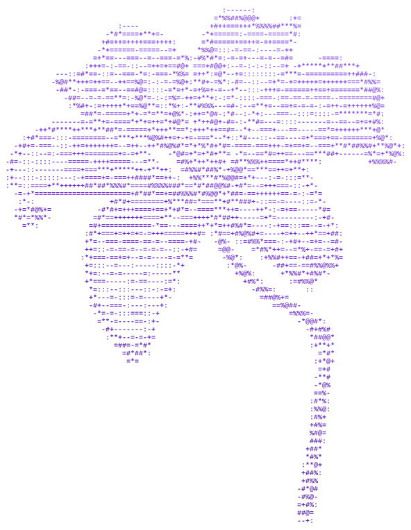

## Hi, I'm cupid82

<picture>
  <source media="(prefers-color-scheme: dark)" srcset="assets/flower-dark.svg">
  <source media="(prefers-color-scheme: light)" srcset="assets/flower-light.svg">
  
</picture>

**Software developer** · full-stack web · applied AI · systems programming

I like taking an idea from an empty folder to something people can open and use, and understanding every layer on the way. So far that has meant an astronomy pipeline, a student platform, a trading dashboard with a local LLM, and a browser game.

- **Now:** building **Zavion**, a layer-1 blockchain in Rust, written from scratch
- **Recently:** CosmoLens HPC, a JWST image pipeline paired with Gemini (MLH hackathon)
- **Exploring:** local LLMs, multimodal AI and distributed systems
- **How I work:** small, verified steps and code I can explain line by line

 

### Tech stack

### Selected work

| Project | What it does |
| --- | --- |
| [**CosmoLens HPC**](https://github.com/cupid82/cosmosX) | Finds gravitational lenses and high-redshift galaxy candidates in James Webb deep-field images: a multi-core Python pipeline measures every source, then Gemini 2.0 reviews the candidates. Python · Gemini API · MLH hackathon |
| [**OAA**](https://github.com/cupid82/OAA_showcase) [live demo](https://oaa-showcase.amithd252.workers.dev/) | A student skills-and-opportunity platform: project stories, events and jobs, a private burnout check and an opt-in leaderboard, sitting beside the college ERP. React · TypeScript · Express · Tailwind |
| [**Zeninx**](https://github.com/cupid82/Zeninx) | Live TradingView charts next to a locally running Qwen model, streamed through a small Node proxy; also packaged as a Windows app. Node.js · Ollama |
| [**Level Devil**](https://github.com/cupid82/level_devil) | 24 troll-platformer levels in plain JavaScript, with particle effects and a Web Audio synth for every sound: no engine, no audio files. JavaScript · Web Audio |

### Contribution snake

<picture>
  <source media="(prefers-color-scheme: dark)" srcset="https://raw.githubusercontent.com/cupid82/new-profile/output/snake-dark.svg">
  <source media="(prefers-color-scheme: light)" srcset="https://raw.githubusercontent.com/cupid82/new-profile/output/snake-light.svg">
  
</picture>

Redrawn every 12 hours by a GitHub Action. The lily is ASCII art generated from my own artwork.
